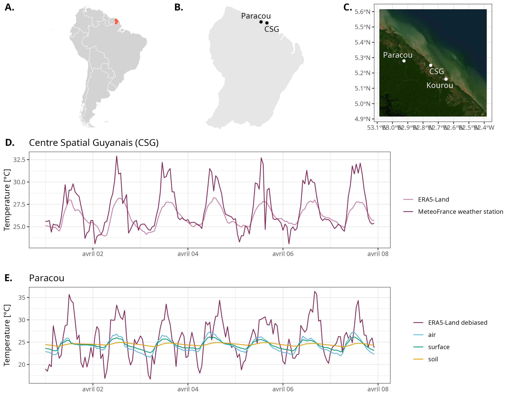
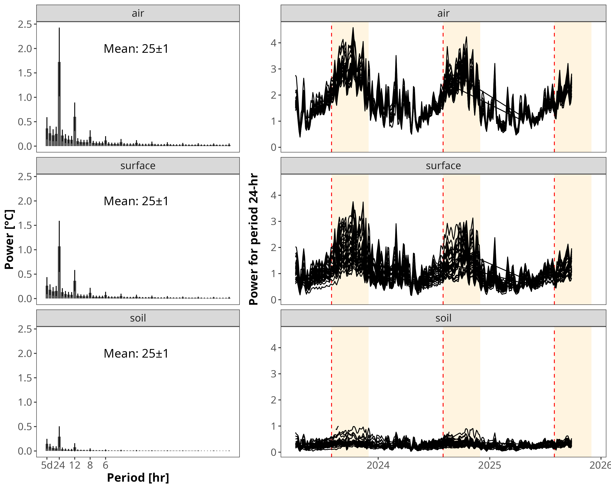
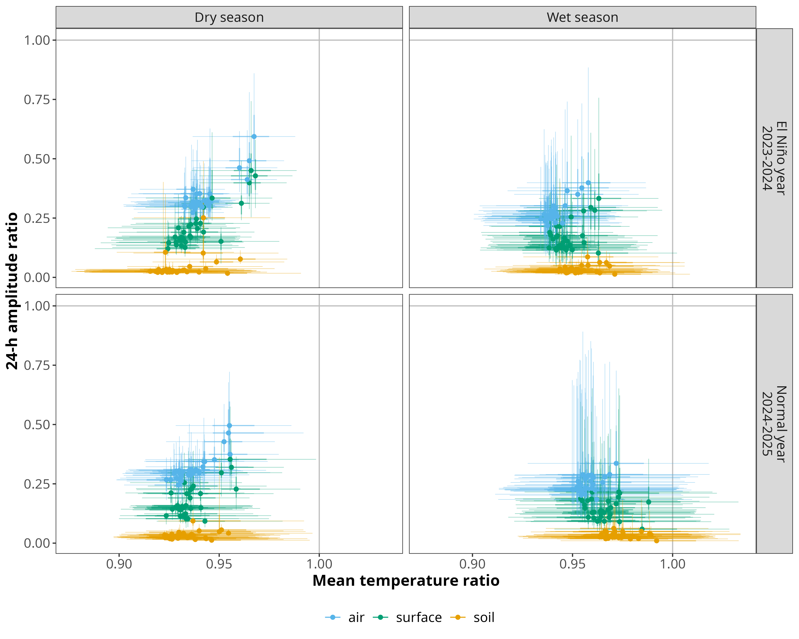
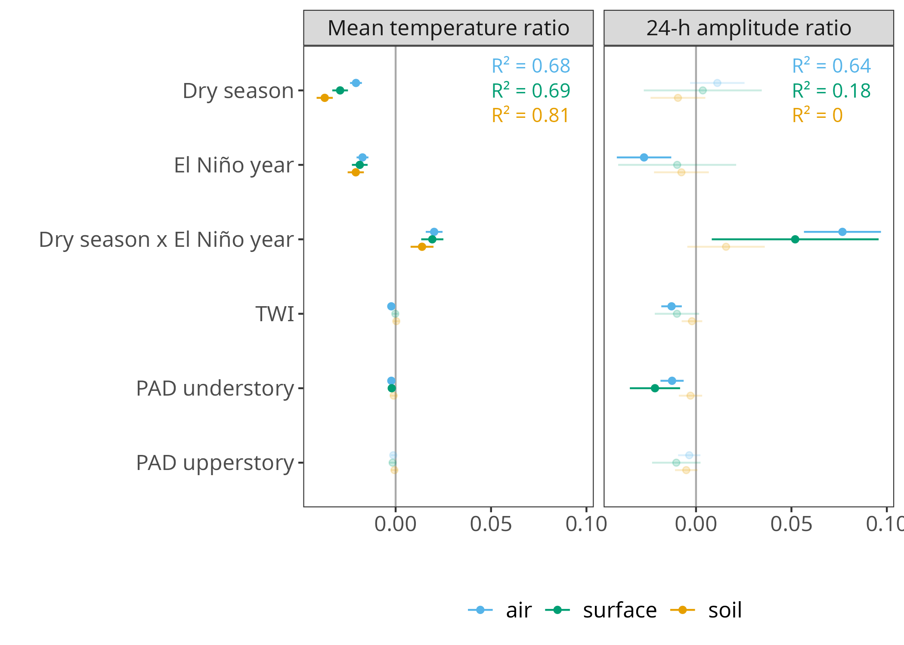
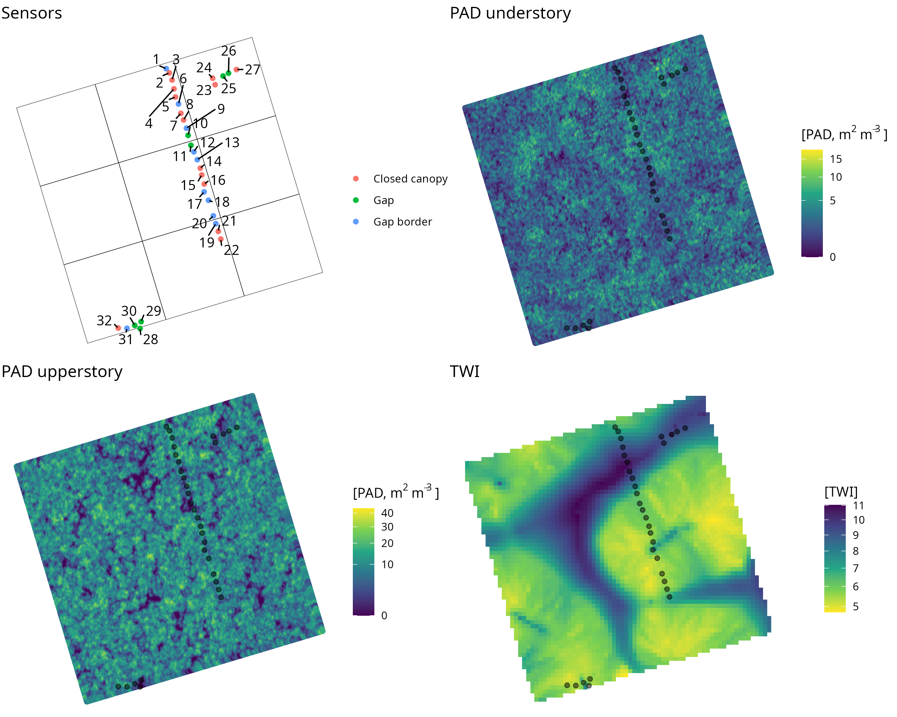
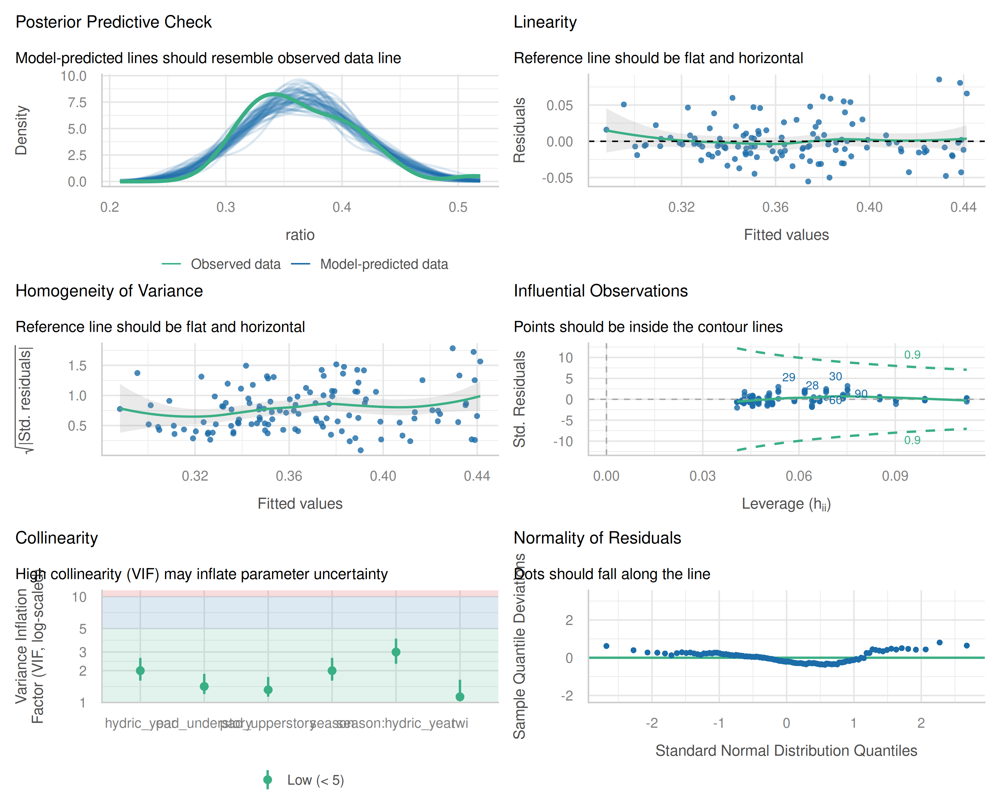

# Manuscript {.unnumbered}

This appendix is the final manuscript

**Title**: "Topography and vegetation moderate understory microclimate buffering, but El Niño dry seasons overwhelm forest thermal refugia in Amazonia

**Authors**: *Sylvain Schmitt (1,2), Erwan Hingant (3), Vincyane Badouard (4), Géraldine Derroire (1,2), Léa Françoise (5), Giacomo Sellan (5), Grégoire Vincent (4), Jérôme Chave (6), Jonathan Lenoir (7)*

**Aim**: *Global Change Biology*

**Cover letter**:

## Affiliations

1 - CIRAD, UPR Forêts et Sociétés, F-34398 Montpellier, France\
2 - Forêts et Sociétés, Univ Montpellier, CIRAD, Montpellier, France\
3 - UMR CNRS 7352 "Laboratoire Amiénois de Mathématique Fondamentale et Appliquée" (LAMFA), Université de Picardie Jules Verne, 33 rue St-Leu, 80000 Amiens, France\
4 - AMAP, ADEME\
5 - ECOFOG\
6 - CRBE, CNRS\
7 - UMR CNRS 7058 “Ecologie et Dynamique des Systèmes Anthropisés” (EDYSAN), Université de Picardie Jules Verne, 1 rue des Louvels, 80000 Amiens, France

## Abstract

*Abstract.*

### Keywords

*Keywords.*

## Introduction

Introduction.

Microclimate definition MEB 2026 and link to CC, see <https://onlinelibrary.wiley.com/doi/10.1111/gcb.71140> .

@defrenne2024

- Why - microclimate local buffering after debiasing
- What - understory soil, air and surface temperature
- How - Tomst TMS4
- When - 2 hydric years multitemporal analysis with El Nino year
- Where - Paracou with fine scale spatial resolution but only a few ha
- Sites - Vegetation density and microtopography both from lidar
- Reference - ERA5-Land corrected against local MeteoFrance weather data
- Analyses - Discrete Fourier Transform
- Publication - Open data and code with reproducible R + Quarto analyses

## **Material and methods**

### **Study site and data**

#### Tree inventories

Our study site is a 9-ha subset of the P16 plot located in Paracou, in the commune of Sinnamary, French Guiana (5.258°N, 52.937°W. @fig-1). Paracou is characterized by a mean annual temperature of 26 °C and annual precipitation of 3,000–3,100 mm. The wet season lasts from approximately December to July, the dry season from August to November, and there is a shorter dry period around March [@aguilos2018]. The soils in Paracou are predominantly Acrisols with localized patches of sandy Ultisols. The bedrock is a Precambrian metamorphic rock composed of schist and sandstone [@stahl2011]. Situated within a dissected topography, our study site is characterized by a series of relatively small hills separated by narrow drainage valleys and streams. Hills typically range from 100 to 300 m in diameter and rise approximately 20–35 m above the surrounding terrain, with slopes ranging from 25 to 45% [@vincent2010]. The plot consists of a 300 m × 300 m section of lowland rain forest in which all trees and palms with a diameter at breast height (DBH) ≥ 1 cm were tagged, measured, spatially mapped, and identified. Structurally, our 9ha subplot has a stem density of 4646 (± 363) stems ha-1 and a basal area of 35.6 (± 5.1) m²ha⁻¹ for trees ≥ 1 cm DBH (Sellan, pers. comm.), whereas on the whole P16 mean canopy height was 32 m [@vincent2012].

#### Microclimate sensors and macroclimate reanalysis

32 Tomst TMS-4's sensors were spaced 10 m apart, with a minimum distance of 1 m from the HOBO sensors to avoid ground disturbance caused by the HOBO stakes. Tomst sensors measured air (15-cm), surface (0-cm) and soil (-8-cm) temperatures. Acquisition began on 1 May 2023. with a temporal resolution of 15 minutes and protection against direct light and rain (although some sensors still overheated in the sunshine). The sensors were located across transects that covered topographical gradients and forest canopy openness (@fig-s1). Data were retrieved until 30 September 2025 (@fig-2).

We retrieved macroclimatic data from ERA5-Land [@muñoz-sabater2021a] at both Paracou and at the nearest MétéoFrance weather station from Kourou space center (CSG, @fig-1). We also retrieved the public data from the CSG MétéoFrance weather station [@meteofrance2026].

#### Environmental descriptors

We used high penetration lidar [@badouard2025] to compute Plant Area Density (PAD) derived from 1m3 voxels using AMAPVox [@vincent2017] and Topographic Wetness Index (TWI) at a 5m pixel resolution using the package RSAGA [@brenning2008; @conrad2015]. The TWI characterises surface drainage, the associated water availability gradient and is correlated to the soil fertility gradient on the study site [@schmitt2021]. The TWI is computed as a function of local slope angle and the neighbouring maximum values of drainage area [@bohner2006]. We interpolated for each microclimate sensor the PAD vertical column above the sensor with a 3m buffer and the corresponding TWI values (@fig-s1). We further aggregated PAD values and in the sum of the understory vegetation below 10-m and upperstory above 10-m.

```{r fig1}
#| label: fig-1
#| fig-cap: 'Figure 1: Study sites and temperature time series in French Guiana. (A) Location of French Guiana within South America. (B) Location of the two study sites, Paracou and Centre Spatial Guyanais (CSG), in the Kourou region of French Guiana. (C) Satellite view of the study area showing Paracou, CSG, and Kourou. (D) Comparison of air temperature at CSG from ERA5-Land reanalysis and an in-situ MeteoFrance weather station over one week (April 1–8), showing that ERA5-Land captures the diurnal cycle but underestimates daily temperature maxima. (E) Comparison of bias-corrected ERA5-Land air temperature ("ERA5-Land debiased") with microclimate measurements at Paracou (air, surface, and soil temperature) over the same period, illustrating the buffering effect of the forest canopy and soil on temperature extremes relative to the free-air reanalysis estimate.'

```

### **Discrete Fourier Transform and statistical analyses**

#### Macroclimate debiasing

We debiased ERA5-Land macroclimate data using the relationship between the Fourier coefficients after decomposition of ERA5-Land and the CSG weather station [@schmittinprep]. We used the full time series for the Fourier transform, since missing data could not be accommodated. We focused on the microclimate study years 2023–2025. The weather station data were missing only nine measurements across six days, so we filled these using local linear interpolation, yielding 365 and 366 days (2024 being a leap year), each at hourly resolution. This produced a large two-year power spectrum, with most power concentrated at the mean and periods of 24, and 12 hours and their harmonics, as well as between periods of two years and one day. The power ratio between ERA and the weather station showed that ERA power decreased relative to observed power as frequency increased, consistent with a reanalysis smoothing small-scale temporal variations. However, even at low frequencies and periods longer than 24 hours, weather station power remained higher than ERA5-Land power. We used this ratio, computed for the Kourou CSG station, to interpolate the debiased ERA5-Land data back to the Paracou station for 2023–2025.

#### Microclimate buffer computation

We decomposed the temperature series for both the debiased macroclimate of ERA5-Land reanalysis in Paracou and the temperature series from Tomst microclimate sensors, which recorded either air, surface or soil temperatures. We used Fourier transform decomposition with a sliding window of five days and a shift of three days, analysing only complete data series. Based on this decomposition, we created power spectra for air temperatures, which highlight the power of temperature variation (°C) per period or frequency (here, period in hours; [see @schmittinprep for further explanation on the methodology]). We then computed the microclimate buffers as the ratio of mean temperature and power for the 24-hour period for the Tomst microclimate sensors, compared to debiased macroclimate of ERA5-Land reanalysis.

#### Spatio-temporal linear model

To assess the drivers of microclimate buffering, we modelled the buffer ratios (temperature and power, see above) as a function of seasonal, interannual and structural forest covariates. For each combination of variable (mean temperature or 24-hour power ratio) and sensor type (air, surface, soil), we fitted a separate linear model, with the buffer ratio as the response variable:

Ratio \~ Season × Hydric year + TWI + PAD understory + PAD upperstory

Season was coded as a two-level factor (wet, dry), and hydric year was recorded from the onset of dry-season (1st of August) across calendar-year pairs into a two-level factor contrasting a normal rainfall year (2024–2025) against an El Niño-affected year (2023–2024, "normal" set as the reference level). The interaction between season and hydric year allowed the effect of season on the buffer ratio to differ depending on the prevailing hydrological regime. Topographic Wetness Index (TWI) and Plant Area Density, separated into understory (\<10 m) and upperstory (\>10 m) components, were included as continuous covariates and standardised prior to fitting, so that their coefficients are directly comparable in magnitude. Models were fitted independently for each period (temperature vs. 24-h power) and each sensor type (air, surface, soil).

## **Results**

Data acquisition resulted in measurements for 32 sensors across three height/depths and two full hydric years. We computed the power spectrum decomposition (see Methods) for the 21,783 five-day windows, with a three-day sliding window (@fig-2). We found that daily variations with 24-hour periods and their harmonics drove temperature variations in air, surface, and soil temperatures, all of which had a mean temperature of 25°C. However, power and amplitude were reduced in air temperatures compared to surface and soil temperatures (e.g. power was 1.72°C, 1.07°C, and 0.293°C, respectively, for a period of 24 hours). Focusing on the daily variation with a period of 24 hours, we found amplified power and amplitude during the dry season for air and surface temperatures, particularly during the dry season of 2023–2024 (an El Niño year), whereas the soil signal remained comparatively stable and of low amplitude throughout the study period.

```{r fig2}
#| label: fig-2
#| fig-cap: 'Figure 2: Mean power spectrum decomposition and temporal dynamics of the 24-hour power peak. (Left) Mean power spectra (°C) as a function of period (in hours, decreasing from 5 days to a few hours) for air, surface, and soil Tomst sensors, obtained through Fourier decomposition using a 5-day sliding window (3-day shift) over the full acquisition period (May 2023–September 2025). All three panels show power strongly concentrated around the 24-hour period (diurnal cycle) and its 12-hour harmonic, with power decreasing at shorter periods. The intensity of the diurnal peak declines markedly from air to surface to soil, reflecting the progressive damping of the thermal signal with depth. The mean temperature (± SD) over the full period is indicated in each panel (25 ± 1°C for all three compartments). (Right) Time series of power at the 24-hour period, extracted for each sliding window and for each of the 32 sensors (one line per sensor), shown separately for air, surface, and soil from 2023 to 2026. Shaded yellow areas indicate dry seasons, and vertical dashed red lines mark the start of each dry season (or hydric year) considered in the analyses.'

```

By computing the mean temperature and 24-hour amplitude ratios against the ERA5-Land reanalysis, which was adjusted for a local weather station (see Methods), we found that the forest microclimate generally has a buffering effect relative to the macroclimate (see @fig-3; all mean amplitude ratios remain below 1). The adjusted ERA5-Land mean temperature was 26.7°C, with an associated 24-hour daily amplitude power of 2.09°C. This corresponded to a buffer of 1.3–1.5°C (5–6%) on mean air, surface and soil temperatures, as well as to a buffer of 1.5–2.0°C (71–96%) on associated 24-hour daily amplitude powers . The buffering effect was strongest and most consistent for soil, intermediate for the surface and weakest for the air. The buffering was more pronounced in the dry season than in the wet season, particularly for the 24-hour amplitude ratio. However, differences between El Niño and normal hydric years are unclear.

```{r fig3}
#| label: fig-3
#| fig-cap: 'Figure 3: Microclimate buffer ratios of mean temperature and 24-hour amplitude across years, seasons, and sensor depth. For each of the 32 microclimate sensors, points show the median ratio between the Tomst-measured microclimate and the debiased ERA5-Land macroclimate, for mean temperature (x-axis) and for the 24-hour power amplitude (y-axis), computed across all sliding windows within each season and hydric year. Thick segments indicate the 50% distribution (25th–75th percentile) and thin segments the 90% distribution (5th–95th percentile) of the ratio for each sensor. Points are colored by sensor type: air (blue), surface (green), and soil (orange). Panels are split by season (columns: dry vs. wet) and by hydric year (rows: El Niño year 2023–2024, top; normal year 2024–2025, bottom). Grey vertical and horizontal reference lines mark a ratio of 1 (i.e., no difference from the macroclimate), and the horizontal arrows summarize the interpretation of the x-axis, from buffering (ratio < 1, microclimate cooler/less variable than macroclimate) to amplifying (ratio > 1, microclimate warmer/more variable than macroclimate).'

```

We further investigated the variations in mean temperature and 24-hour amplitude ratios using a spatio-temporal linear model (@fig-4). For mean temperature, we found that the dry season and the El Niño year each strengthened buffering across air, surface, and soil independently, but their interaction weakened it. Mean temperature models explained a substantial proportion of the variance for all sensor types (R² = 0.68–0.81). For the daily 24-hour amplitude ratio, the effects varied more between the air, surface, and soil. The El Niño year strengthened buffering in the air, but not in the surface or soil. Meanwhile, the dry season × El Niño year interaction strongly weakened buffering (shifting towards amplification) for the air and surface amplitude. This effect was not seen in the soil. The daily 24-hour amplitude ratio model fit was more limited for soil and surface (R² = 0–0.18), but stronger for air (R² = 0.64), reflecting weaker or non-significant relationships for surface and soil amplitude ratios. Spatial covariates linked to topography (TWI) and vegetation structure (PAD) had comparatively small and largely insignificant effects. However, there were two interesting exceptions: (i) PAD only in the understory had a buffering effect on the surface and air mean and daily 24-hour amplitude ratios, and (ii) TWI had a buffering effect on the air mean and daily 24-hour amplitude ratios.

```{r fig4}
#| label: fig-4
#| fig-cap: 'Figure 4: Drivers of microclimate buffer ratios with coefficients from the spatio-temporal linear models. Points show model-estimated coefficients (with 95% confidence intervals) from the linear models relating the mean temperature ratio (left) and the 24-hour amplitude ratio (right) to season, hydric year, their interaction, and forest structural covariates (TWI, PAD understory, PAD upperstory), fitted separately for air (blue), surface (green), and soil (orange) sensors. Coefficients are shown relative to the reference levels (wet season, normal hydric year), so that "Dry season" and "El Niño year" represent the shift in ratio associated with each condition, and "Dry season × El Niño year" represents their interaction. Transparent points indicate coefficients that are not statistically significant (95% CI overlapping zero). Solid points indicate significant effects. The vertical grey line marks a coefficient of zero (no effect), and the horizontal arrows summarize the interpretation of the x-axis, from a stronger buffering effect (+buffer, coefficient < 0) to a weaker or reversed buffering effect (−buffer, coefficient > 0). Marginal R² values for each model are given in the top-right corner of each panel, colored by sensor type. Hypotheses testing behind the linear model are shown in @fig-s2. Detailed regressions parameters and significance are given in @tab-s1.'

```

## **Discussion**

Understorey buffering in Paracou was strong under normal conditions. On average, the air, surface and soil were 1.3–1.5°C cooler, and the daily temperature amplitude was reduced by 1.5–2.0°C. However, this buffering was not a fixed property of the forest. During the dry season of the 2023–24 El Niño event, it weakened considerably, particularly with regard to the daily amplitude of air and surface temperatures. This suggests that there may be a tipping point when the forest is subjected to compound heat–drought stress. Season and hydric year explained far more variation than vegetation structure or topography at this fine scale. Therefore, microrefugia models based solely on structure may overestimate the protection that forest understories will offer during future El Niño events. Replication across sites and multiple ENSO cycles is needed to test this.

### **Overall buffering pattern**

We observed an overall buffering pattern of air, surface and soil temperatures in the Paracou tropical forest. Mean temperature was 1.3–1.5°C cooler and (24-hour) amplitude power was reduced by 1.5–2.0°C. Mean and daily (24-hour) amplitude ratios remained below 1, consistent with pan-tropical buffering of temperature variation by the forest understorey [global mean of 1.6°C, @ismaeel2024]. This finding is also consistent with global buffering studies that highlighted strong buffering in the tropics [@defrenne2019]. Our work complements biogeographical studies by exploring local variation on a finer spatial and temporal scale than previous studies [@lembrechts2020]. Temperature amplification was rarely observed, only for daily amplitude ratios in the wet season, mainly in normal years during the period of the lowest observed mean temperature, when the soil might have a warming effect.

The strength of the buffering increased with distance from the atmosphere-vegetation interface. Topsoil experienced higher buffering than the surface, which in turn experienced higher buffering than air temperatures. This is in line with previous studies of temperate [@gril2024] and tropical [@ewers2013] forests. This was particularly evident for mean temperature, whereas the effect was less pronounced for daily amplitude (24-hour), when the buffering could be similar across layers and even inversely proportional during the wet season. This is consistent with increasing thermal inertia and decoupling from atmospheric forcing with depth, as demonstrated by previous modelling studies [@zhang2023]. Topsoil temperature was almost insensitive to season, year or vegetation structure (R² = 0.05).

### **Seasonal and interannual forcing dominate over local structure**

Statistical modelling revealed that the dry season strengthened the buffering of mean temperatures across air, surface, and soil temperatures during the 2024–25 normal hydrological year. This contradicts a previous pan-tropical analysis [@ismaeel2024], but is consistent with recent findings in French Guiana [@hes2025]. This raises the question of whether the difference is spatial (e.g. specific to the Guiana Shield) or methodological. As @ismaeel2024 demonstrated a congruent increase in the diurnal temperature range during the dry season in the Amazon region, a methodological difference is a plausible explanation. Applying a similar decomposition to a larger-scale dataset [@schmittinprep] would help to resolve this.

The El Niño year of 2023–24 also had a strengthening effect, suggesting that processes such as shading and cooling remain effective even under moderate stress during the El Niño wet season. However, the interaction between the dry season and El Niño reversed this pattern, with the most striking example being the weakening of microclimate buffering in the 24-hour air and surface temperature amplitude ratio. This interaction indicates that the threshold at which the forest microclimate buffering system breaks down under heat–drought stress may be approaching. This is consistent with the pattern identified by @hes2025 in Paracou, where buffer loss was observed during the 2023–24 dry season. However, the response of other sites in French Guiana during the same period differed in @hes2025, highlighting the need for a framework that can distinguish between the different effects of season, hydric years, and buffer temporal resolution. Indeed, our methods could be applied to previous and future temperature time series, given that El Niño events are becoming more frequent. Examples include the past 2015/16 El Niño event [@jimenezmunoz2016], the 2023/24 El Niño event studied here, and the incoming 2026/27 El Niño event [@liu2026].

The interaction between the dry season and the 2023–24 El Niño event suggests that the combined effect of these climatic extremes was greater than, and opposite to, their individual effects, resulting in loss of thermal buffering capacity. Furthermore, temperature increase is not the only climatic factor impacting vegetation; hot days are also linked to a precipitation deficit [@mueller2012], resulting in higher atmospheric demand for water (high VPD) and a higher soil water deficit, resulting in compound dry and hot events. These findings mirror the results of recent remote sensing studies of Amazonian vegetation using radar, which indicate a severe decline in forest function during severe droughts [@tao2022].

Interestingly, the interaction effect was concentrated in the 24-hour daily amplitude rather than the mean temperature. This implies that the primary biological risk during hot and dry events is an increase in the daily thermal range (i.e. larger temperature fluctuations) in the understorey, rather than an increase in the average temperature. This is highly relevant when interpreting the thermal tolerance and heat stress exposure of trees, plants, and more generally, understorey organisms. Indeed, thermophilization and the climatic lag in forest plant communities are primarily controlled by microclimate [@zellweger2020]. Leaf temperature increases non-linearly with ambient air [@doughty2023], including microclimate temperature in the understorey. Critical thresholds are starting to be observed in canopies [@doughty2023], and these could extend to the understorey if the loss of buffering during El Niño dry seasons is underestimated. The impact generally depends on both the degree of warming and the number of species at risk, as well as their physiological sensitivity to warming and their capacity for behavioural and physiological compensation [@huey2009]. Tropical animals may experience a slower increase in temperature, but they may already be approaching temperature limits [@tewksbury2008]. Almost two decades ago, thermoconformer lizards from tropical forests were already shown to be at risk [@huey2009].

### **Role of vegetation structure and topography**

Other than the temporal descriptors, the statistical modelling revealed spatial effects: a vertical effect due to vegetation density and a horizontal effect due to topography. The density of understory vegetation, represented by plant area density below 10 metres and not that of the upper story (\>10 metres), had a significant effect on the 24-hour amplitude ratio for surface and air temperatures. This supports the idea that near-ground vegetation plays a role in stabilising the microclimate independently of the canopy cover above 10 metres. Previous studies in temperate forests have highlighted the role of vegetation [@gril2023; @davis2019], although they did not specify particular layers. However, these studies were conducted in shorter, less vertically complex forests. In contrast, @jucker2018 also found an effect of whole vegetation structure through canopy height in Malaysian forests up to 80 m tall. Their study, however, was conducted on a landscape scale, with a wider variation in vegetation structure (from 0 to 80 m), which might explain why we did not observe the effect of the entire vegetation structure column. At a finer spatial scale, @tymen2017 showed in French Guiana that light penetration accounted for around half of the variation in maximum understorey temperature at Nouragues. While their findings emphasise the significant impact of canopy openings on understorey thermal conditions, our study indicates that vegetation density beneath the upper canopy may also play a role in microclimate buffering. This is particularly relevant given that differences in aerial LiDAR acquisition can result in understorey vegetation being undersampled, as was the case for @tymen2017 and in previous studies, compared to the high-penetration acquisition used here [@badouard2025]. In our study, past forest gaps may have resulted in locally dense understorey vegetation owing to lateral light access for intermediate strata, which may favour increased buffering near the ground at fine spatial scale.

At a fine scale of a few metres, topography was represented by the topographic wetness index and had a minor effect. This suggests that, at a fine scale, topography and hydrology are less important than seasonal and interannual climate in shaping the buffering capacity at the Paracou station. However, this does not negate the effect at a landscape scale, given the small size of our study area. Indeed, @baraloto2010, also working at Paracou, identified topographic position as a major driver of understory microclimate, with plateau, midslope and bottomslope positions explaining 26% of midday air temperature and 48% of soil temperature variation. However, their measurements were restricted to a single midday snapshot during the dry season (September 1999), whereas our continuous measurements capture temporal dynamics and allow us to assess the relative importance of spatial and temporal drivers across different conditions. @tymen2017 demonstrated the importance of microtopography on relative humidity at the Nouragues station in French Guiana, which was not studied here but is likely to be indirectly linked to air temperature. @davis2019 found a stronger effect of topography on driving near-surface maximum and minimum temperatures in a mountain context with stronger topography than that studied here. Similarly, @jucker2018 found that topography was a strong predictor of local microclimate in Malaysian forests, with elevation and terrain curvature primarily constraining daily mean temperatures, but at landscape scale. Once again, this calls for extending our study to a larger area to explore the effect of topography.

In general, our study revealed that forest vegetation, forest structure, and topography explained little variance compared to the effects of season and hydric year, suggesting that vegetation structure only marginally moderates buffering and that seasonal and interannual extremes are the main drivers. However, this interpretation should be tempered by the small study area, which exhibited reduced variation in vegetation density (6±3 m2.m-2) and reduced topographic variation compared to previous studies [@baraloto2010], and was based on only two transects.

### **Broader implications**

Our results and those of previous studies caution against microrefugia models based solely on vegetation structure, since even dense, structurally intact old-growth forests lost their typical buffering capacity during a compound heat–drought event [@trew2024]. Thermal refugia depend on the climate state rather than being a fixed property of the habitat. Using sensors and modelling, @delombaerde2022 predicted greater buffering capacity for tropical forests in a changing climate, without considering the compound effect of El Niño. However, El Niño is expected to become more frequent and severe due to climate change [@cai2014; @cai2021], including the current 'super El Niño' [@liu2026]. This could reduce the ability of forest understories to protect Amazonian forests during droughts and heatwaves (when buffering is most needed).

Our findings highlight the need for more extensive physiological and phenological monitoring (e.g. leaf area dynamics and canopy water status) during future El Niño events, in order to identify the factors that cause temperature buffer collapse, such as stomatal closure, reduced transpirational cooling and leaf shedding. Preliminary analyses have identified a decrease in gross primary productivity in Amazonian forests during the 2023–24 El Niño event, accompanied by an increase in vapour pressure deficit [@meunierinprep]. This leads to a decrease in stomatal conductance and photosynthesis [@slot2024] because VPD exerts stronger control over stomatal closure than temperature does directly. Closing stomata reduces tree transpiration and thus the cooling of the canopy by transpiration. During dry seasons, tropical forests also rejuvenate the canopy, which is associated with leaf shedding that controls leaf transpiration [@gong2022]. Recent literature has revealed the renewed importance of phenology and leaf shedding for Amazonian and tropical forest fluxes, which must be considered to improve our understanding of the loss of buffering capacity during a compound El Niño dry season [@wu2017; @wu2021; @yang2021; @chen2019].

### **Limitations and future directions**

Our results are based on a single 9-hectare plot and a comparison of just two hydric years (one El Niño and one normal), which imposes a strong limit on the generality of our interpretation. Replication is required to confirm the applicability of the buffering-collapse threshold. Data acquisition has been underway for several years at other sites (e.g. the Nouragues station), but similar analyses require fine-scale vegetation descriptions using LiDAR [@badouard2025], multi-year monitoring of extreme climatic events and, above all, good, fine-scale spatialisation of sensors in order to correctly link microtopography and vegetation conditions to each sensor. As microclimate acquisitions are expanding (French Guiana, 2014–2024, [@hes2025]; tropics, 2016–2021, [@ismaeel2024]; all key biomes, 50 countries, [@lembrechts2020]), future studies could adopt our approach to test its generality across different types of vegetation and extreme climate events.

However, fine-scale microclimate data remain scarce among the cited studies, especially in tropical forests and even more so in the Amazon during El Niño events. Existing microclimate studies tend to rely on short campaigns and have coarser temporal and spatial resolutions, which limits their ability to detect threshold and interaction effects. The exceptions are mainly linked to studies on fragmentation. In order to predict where and when thermal refugia will fail under future climate extremes, we need to expand the number of long-term microclimate monitoring stations (spanning multiple ENSO cycles) in the tropics. By providing a rare empirical insight into the effects of compound climatic stress, our dataset is a first step in this direction.

## **Acknowledgements**

- ANR ALT ANR-21-CE32-0009
- PEPR FORESTT MONITOR ANR-24-PEFO-0003
- PEPR FORESTT MICROFOREST ANR-24-PEFO-0007
- thematic network FORTRAN (GDR 2199: <https://www.fortran.cnrs.fr/>)
- ALT measurements teams?

## **Author contributions**

Concept: Sylvain Schmitt, Erwan Hingant, Jonathan Lenoir

Data: Vincyane Badouard, Géraldine Derroire, Léa Françoise, Giacomo Sellan, Grégoire Vincent, Jérôme Chave

Analyses: Sylvain Schmitt, Jonathan Lenoir

Writing (lead): Sylvain Schmitt, Jonathan Lenoir

All authors contributed critically to the drafts and gave final approval for publication.

## **Data availability**

Code: <https://github.com/sylvainschmitt/microclimalt> + Zenodo DOI

Data: What can be shared and how?

## **Supplementary material**

```{r figs1}
#| label: fig-s1
#| fig-cap: 'Figure S1: Sensor locations and forest structural and topographic descriptors at Paracou. (Top left) Spatial layout of the 32 Tomst microclimate sensors within the 9-ha study plot (divided into 1-ha subplots), colored by canopy condition: closed canopy (red), gap (green), and gap border (blue). Sensors were arranged along transects designed to capture variation in canopy openness across the plot. (Top right) Plant Area Density (PAD, m² m⁻³) summed over the understory (<10 m height), derived from lidar-based voxel data (1 m³ resolution) using AMAPVox, with sensor locations overlaid (black dots). (Bottom left) PAD summed over the upperstory (>10 m height), shown at the same resolution and with the same sensor overlay, highlighting canopy gaps as areas of low PAD. (Bottom right) Topographic Wetness Index (TWI) at 5-m pixel resolution, with sensor locations overlaid, showing the topographic gradient (e.g., valley bottoms with high TWI vs. ridges with low TWI) captured by the sensor transects. For each sensor, PAD (understory and upperstory) and TWI values were extracted using a 3-m buffer around the sensor location for use as covariates in the statistical models.'

```

```{r figs2}
#| label: fig-s2
#| fig-cap: 'Figure S2: Model diagnostics for the linear model of the 24-hour amplitude ratio (air). Diagnostic checks for the linear model relating the air 24-hour amplitude ratio to season, hydric year, their interaction, TWI, PAD understory, and PAD upperstory. (Top left) Posterior predictive check comparing the density of the observed ratio (green) to densities simulated from the fitted model (blue), showing good overall agreement in shape and location. (Top right) Linearity check: residuals plotted against fitted values, with a smoothed reference line remaining close to zero across the range of fitted values, indicating no strong non-linear pattern. (Middle left) Homogeneity of variance: square-root of standardized residuals against fitted values, with a roughly flat smoothed trend suggesting no strong heteroscedasticity, though residual spread increases slightly at higher fitted values. (Middle right) Influential observations: standardized residuals against leverage, with dashed contour lines indicating a Cook s distance threshold of 0.9; all points fall within the contours, indicating no highly influential observations. (Bottom left) Collinearity: variance inflation factors (VIF, log scale) for each model term, all falling within the "low" range (VIF < 5, green shading), indicating no problematic collinearity among predictors. (Bottom right) Normality of residuals: quantile-quantile plot of standardized residuals against the standard normal distribution, showing residuals following the reference line closely except for minor deviations in the upper tail. Overall, the model satisfies standard linear regression assumptions reasonably well.'

```

```{r tabs1}
#| label: tab-s1
#| fig-cap: 'Table S1: Summary of the six linear models of microclimate buffer ratios. Model coefficients (estimates, 95% confidence intervals, and p-values) for the linear models relating mean temperature ratio (period "0") and 24-hour amplitude ratio (period "24") to season, hydric year, their interaction, TWI, PAD understory, and PAD upperstory, fitted separately for air, surface, and soil sensors (six models total, each n = 120 sensor–window observations). Bold p-values indicate statistically significant terms (p < 0.05). Across all six models, R² ranged from 0.05 (24-h amplitude ratio, soil) to 0.82 (mean temperature ratio, soil), explaining on average 62% of the variance in buffer ratios; models of the mean temperature ratio consistently outperformed those of the 24-hour amplitude ratio, and among the amplitude-ratio models, air was best explained (R² = 0.66) while soil was essentially unexplained by the included predictors (R² = 0.05).'
knitr::include_graphics("figures/tables1.html")
```
